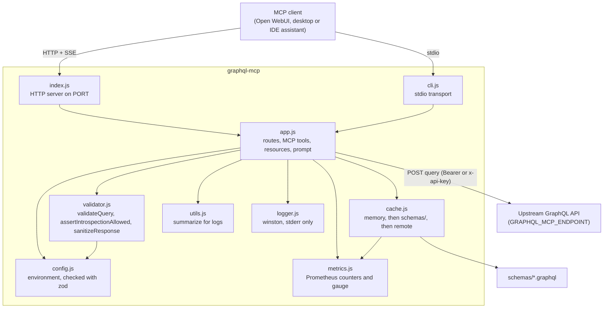

# Architecture

DirectQL is a stack of four services. Only `graphql-mcp` is code kept in this repository
(`mcp/graphql-mcp/`, Node.js, ESM); the other three run upstream images wired together in
[`docker-compose.yml`](../docker-compose.yml) and `infra/`. The system diagram and one request
workflow are in the [README](../README.md#system-architecture). This page shows the inside of
`graphql-mcp`.

## Components of `graphql-mcp`

Every box is a file in `mcp/graphql-mcp/src/`.

| File | Role |
| --- | --- |
| `index.js` | Starts the Express app from `app.js` on `PORT` (HTTP and SSE mode). |
| `cli.js` | Runs the same MCP server over stdio, for clients that start it as a command. |
| `app.js` | Express routes (`/health`, `/metrics`, `/openapi.json`, `/sse`, `/messages`), the rate limiter, the MCP tools `query-graphql` and `introspect-graphql-schema`, the resources `graphql://schema` and `graphql://local/<file>`, the prompt `write-graphql-query`, and the stateless JSON-RPC handler behind `POST /sse`. |
| `config.js` | Reads `.env` and the process environment; exits on invalid values. Keys are listed in [`.env.example`](../.env.example). |
| `validator.js` | Checks a query before it is sent (syntax, read-only mode, depth, optional complexity, schema) and strips stack traces from upstream errors. |
| `cache.js` | The three-tier schema cache, see [CACHE.md](CACHE.md). |
| `metrics.js` | Registry behind `GET /metrics`. |
| `utils.js`, `logger.js` | Log helpers: `summarize` shortens long values; the logger writes every level to stderr. |

## What happens on `query-graphql`

1. `app.js` rejects a mutation when `GRAPHQL_READ_ONLY` is `true` (the SSE tool path), then calls `executeGraphQL`.
2. `executeGraphQL` gets the schema from `cache.js` (memory, then `schemas/<key>.graphql`, then an introspection query to the endpoint). If that fetch fails it logs a warning and validates syntax and limits only.
3. `validator.js` `validateQuery` applies the read-only, depth, complexity and schema checks.
4. `app.js` sends the query to the endpoint with the `Authorization: Bearer` header (always for `github.com` endpoints or `AUTH_TYPE=Bearer`) or `x-api-key`.
5. `sanitizeResponse` removes `exception` and `stacktrace` from error extensions, and the data goes back to the client.

Threats and their mitigations are in [THREAT-MODEL.md](THREAT-MODEL.md).
